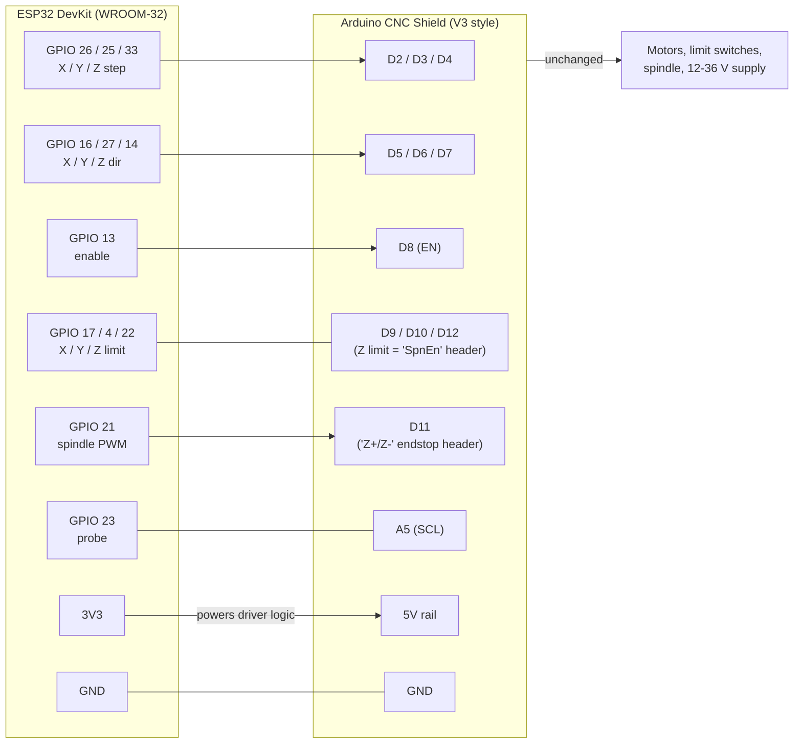

# Wiring: ESP32 DevKit → Arduino CNC Shield (Uno removed)

**What changes:** the shield comes off the Uno. The ESP32 connects to the shield's **underside header pins** with female-female jumper wires (20 cm).

**What doesn't change:**
- motor connectors
- driver modules and microstep jumpers (they set the 80 / 1505 steps/mm)
- limit switch wires
- spindle wire
- the motor power supply on the blue terminal

## Diagram

## Pin map

Shield pins are the Uno pin names printed next to the header (D2, A5, …). GRBL 1.1h pin roles, as your Uno ran them:

| # | ESP32 pin | → Shield (Uno) pin | Function | Shield label (V3) |
|---|---|---|---|---|
| 1 | GPIO 26 | D2 | X step | — |
| 2 | GPIO 25 | D3 | Y step | — |
| 3 | GPIO 33 | D4 | Z step | — |
| 4 | GPIO 16 | D5 | X dir | — |
| 5 | GPIO 27 | D6 | Y dir | — |
| 6 | GPIO 14 | D7 | Z dir | — |
| 7 | GPIO 13 | D8 | Stepper enable (all) | EN |
| 8 | GPIO 17 | D9 | X limit | X-/X+ |
| 9 | GPIO 4 | D10 | Y limit | Y-/Y+ |
| 10 | GPIO 22 | **D12** | **Z limit** (GRBL 1.1 moved it here) | **SpnEn** |
| 11 | GPIO 21 | **D11** | **Spindle PWM** (GRBL 1.1) | **Z-/Z+** |
| 12 | GPIO 23 | A5 | Probe | SCL |
| 13 | GPIO 36 | A1 | Feed hold (only if a button is wired) | Hold |
| 14 | GPIO 39 | A2 | Cycle start (only if a button is wired) | Resume |
| 15 | **3V3** | **5V** | Driver logic power | 5V |
| 16 | **GND** | **GND** | Common ground | GND |

### Why rows 10, 11 and 15 look odd
- **Rows 10–11:** GRBL 1.1 with a speed-controlled spindle swaps D11 and D12. The shield's "Z endstop" header is really the spindle PWM, and "SpnEn" is really the Z limit. The ESP32 follows the **pin numbers**, so the existing wires keep working unchanged.
- **Row 15:** the shield's 5V rail feeds the stepper drivers' logic, and nothing else on it needs 5 V.
  - Fed from **3V3**, A4988 drivers accept the ESP32's 3.3 V signals. Fed from 5 V, they need 3.5 V for a "high", and 3.3 V is too low.
  - DRV8825 drivers work either way.
  - It also means no 5 V signal can ever reach the ESP32.

## Do not
- Connect the ESP32's **5V/VIN** pin to the shield.
- Let the motor supply (12–36 V, blue terminal) touch anything on the ESP32 side.
- Use GPIO 0, 2, 12 or 15. They're boot-mode pins, and the ESP32 may fail to start if they're pulled the wrong way.

## Notes
- **Rows 13–14:** GPIO 34/36/39 have no internal pull-up. If you wire a button there, add a 10 kΩ resistor from that pin to 3V3. Skip these rows if nothing is wired to Hold/Resume today.
- **Spindle PWM is now 3.3 V.** Most PWM→0-10 V and MOSFET spindle boards accept it. If the spindle won't speed up, add a 3.3→5 V level shifter on row 11.
- **Coolant (A3) and Abort (A0)** aren't mapped. Your logs show nothing using them at boot.

## Bench order (before first power-on)
1. Photograph the shield in place, then lift it off the Uno. Keep the Uno: it's a full fallback with the settings still on it.
2. Run the 16 jumpers in the table above. Leave the motor supply **off**.
3. Flash FluidNC to the ESP32 and upload `../fluidnc/config.yaml`. Power from USB only.
4. Check the limit switches show up in the FluidNC web UI.
5. Turn the motor supply on and jog each axis 1 mm at a time.
